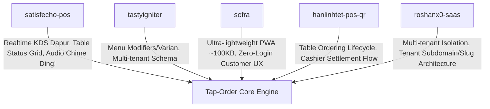

# 🏷️ TAP-ORDER — MULTI-TENANT NFC & QR TABLE ORDERING WITH REAL-TIME CASHIER KDS

> 🤖 **MANDATORY READING FOR AI ASSISTANTS & NEW DEVELOPERS**
> Jika Anda adalah AI Assistant (Claude, Cursor, Copilot, ChatGPT, Antigravity, dll.) atau developer baru yang ditugaskan untuk melanjutkan, mengembangkan, atau memperbaiki codebase ini: **BACA SELURUH DOKUMEN INI SEBELUM MENULIS KODE APA PUN!** 
> Dokumen ini memuat seluruh latar belakang bisnis, arsitektur sistem, aturan keamanan multi-tenant, flow data, dan prinsip fundamental yang tidak boleh dilanggar.

---

## 📌 1. Identitas Produk & Ringkasan Eksekutif

* **Nama Produk**: **Tap-Order**
* **Kategori**: Multi-tenant SaaS F&B Table Ordering & Real-time POS/KDS
* **Target Pasar**: Kafe, Resto, Coffee Shop, Pujasera/Food Court, dan Rumah Makan di Indonesia (skala 8–40 meja).
* **Kepemilikan**: **100% Proprietary (Hak Milik Penuh)**, dibangun secara *in-house* tanpa ketergantungan lisensi komersial pihak ketiga.
* **Tech Stack Inti**: Next.js 15 (App Router), React 19, TypeScript, Tailwind CSS, Prisma ORM, SQLite/PostgreSQL, Server-Sent Events (SSE).

---

## 💡 2. Latar Belakang & Visi Bisnis (The "Why")

### A. Masalah Nyata di Lapangan (Pain Points Kafe/Resto)
1. **Pelayan Kewalahan di Jam Sibuk (*Peak Hours*)**: Tamu sering menunggu 10–15 menit hanya untuk mendapatkan buku menu fisik atau memanggil pelayan.
2. **Pemborosan Biaya Operasional**: Kafe terpaksa merekrut 2–3 staf pelayan tambahan hanya untuk jam ramai (memboroskan gaji Rp 6.000.000 – Rp 9.000.000/bulan).
3. **Peluang Omset Hilang (*Lost Revenue*)**: Tamu malas memesan makanan/minuman tambahan (*repeat order*) karena pelayan sulit dipanggil.
4. **Masalah Solusi POS Lain di Pasar**:
   - Memotong komisi transaksi MDR 1.5% – 2.5% per pesanan.
   - Membutuhkan verifikasi perbankan/KYC rumit dan pencairan dana tertahan berhari-hari.
   - Tamu enggan men-*download* aplikasi baru di Play Store atau mengisi formulir registrasi akun.

### B. Solusi Tap-Order
1. **Zero-Friction Customer Experience**:
   Tamu cukup menempelkan bagian belakang HP (NFC) ke kartu akrilik di meja (atau scan QR cadangan) $\rightarrow$ katalog menu digital bergambar langsung terbuka di browser dalam waktu **$< 1$ detik tanpa download aplikasi** dan **tanpa register/login akun**.
2. **Cashier-Centric Settlement (0% MDR Payment Gateway)**:
   Pesanan dari meja seketika masuk ke layar kasir dan dapur secara *real-time*. Pembayaran diselesaikan langsung di kasir (tunai atau ke rekening QRIS outlet sendiri). **Tidak ada potongan komisi perantara**, uang langsung masuk kasir hari itu juga.
3. **Hardware Akrilik Mewah & Tahan Lama**:
   Meja dilengkapi kartu akrilik ber-chip NFC (NTAG213) dan QR code dengan desain elegan yang menaikkan citra kafe.

### C. Model Bisnis & Harga (Playbook Penjualan UMKM)
* **Paket Starter**: **Rp 99.000 / bulan** (s/d 15 meja, saklar stok habis, rekap omset).
* **Paket Pro**: **Rp 199.000 / bulan** (meja tak terbatas, panggil pelayan & minta bill, multi-kasir, ekspor laporan penjualan).
* **Starter Pack Hardware**: **Rp 350.000** (15 kartu NFC akrilik + standee + onboarding input menu & training kasir 5 menit).
* **Proyeksi Finansial**: 30 kafe pelanggan = **~Rp 5.970.000/bulan MRR pasif** + margin penjualan kartu fisik.
* Rujukan lengkap playbook sales: Lihat [`PITCH_DECK_UMKM.md`](file:///d:/daud/projek%20bisnis/Bismillah/PITCH_DECK_UMKM.md).

---

## 🏛️ 3. Sintesis 5 Repositori Referensi (`_references/`)

Codebase ini dibangun dengan mengadopsi pilar-pilar keunggulan dari 5 repositori *world-class* yang tersimpan di folder `_references/`:



1. **`satisfecho-pos`**: Diadopsi untuk arsitektur KDS dapur real-time, grid visual meja (Hijau = kosong, Kuning = aktif, Merah = minta bill), dan Web Audio API lonceng notifikasi *"Ding!"*.
2. **`tastyigniter`**: Diadopsi untuk pemodelan data relasional menu: kategori, varian (*option groups*: single/multiple choice, level pedas, suhu dingin/panas, delta harga), serta isolasi multi-outlet.
3. **`sofra`**: Diadopsi untuk antarmuka katalog menu tamu yang sangat ringan, mobile-first, dan interaktif.
4. **`hanlinhtet-pos-qr`**: Diadopsi untuk logika pemesanan meja dan alur pembayaran kasir.
5. **`roshanx0-saas`**: Diadopsi untuk pemisahan data aman antar-tenant (*multi-tenant boundary*).

---

## ⚙️ 4. Arsitektur Teknis & Tech Stack

* **Framework**: Next.js 15 (App Router), React 19, TypeScript
* **Styling**: Tailwind CSS + Lucide React Icons
* **Database & ORM**: Prisma ORM dengan **PostgreSQL** (produksi & lokal). Migration versioned di `prisma/migrations/`. SQLite lama (`prisma/dev.db`) hanya arsip, tidak dipakai runtime.
* **Autentikasi & Session**: Custom JWT HMAC-SHA256 (Web Crypto API) tersimpan di cookie `tap_session`.
  * **Role `owner`**: Akses penuh ke dashboard admin (`/admin/[venueSlug]`).
  * **Role `cashier`**: Akses ke layar kasir (`/cashier/[venueSlug]`) dan layar dapur (`/kitchen/[venueSlug]`).
* **Real-time Engine**: Server-Sent Events (SSE) via `ReadableStream` (`/api/stream?venueId=...`) yang dikelola oleh `sseBroadcaster` di `src/lib/sse.ts`.
* **Notifikasi Audio**: Web Audio API (Synthesizer sinus/segitiga) menghasilkan audio chime tanpa perlu memuat file audio eksternal.
* **Format Cetak Struk**: Modul format teks thermal ESC/POS 58mm & 80mm di layar kasir.

---

## 🗄️ 5. Skema Database (`prisma/schema.prisma`)

```
+-------------------------------------------------------------+
|                            Venue                            |
| (id, slug, name, phone, whatsapp, pinCashier, password,    |
|  taxRate, serviceRate, qrisImageUrl, isOpen, ...)           |
+------------------------------+------------------------------+
                               | 1..*
          +--------------------+--------------------+
          |                    |                    |
          v                    v                    v
+-------------------+ +------------------+ +------------------+
|       Table       | |     Category     | |      Order       |
| (id, venueId,     | | (id, venueId,    | | (id, venueId,    |
|  number, label,   | |  name, sort, ...) | |  tableId,        |
|  cardToken,       | +--------+---------+ |  orderNumber,    |
|  status, ...)     |          | 1..*      |  status,         |
+---------+---------+          v           |  subtotal,       |
          | 1..*        +----------------+ |  taxAmount,      |
          |             |    MenuItem    | |  serviceAmount,  |
          |             | (id, venueId,  | |  totalAmount,    |
          v             |  categoryId,   | |  paymentMethod,  |
+-------------------+   |  name, price,  | |  isPaid, ...)    |
|   TableRequest    |   |  isAvailable)  | +--------+---------+
| (id, venueId,     |   +--------+-------+          | 1..*
|  tableId, type:   |            | 1..*             v
|  waiter/bill)     |            v         +------------------+
+-------------------+   +----------------+ |    OrderItem     |
                        |  OptionGroup   | | (id, orderId,    |
                        | (name, type)   | |  menuItemId,     |
                        +--------+-------+ |  priceSnapshot,  |
                                 | 1..*    |  quantity,       |
                                 v         |  optionsJson)    |
                        +----------------+ +------------------+
                        |  OptionChoice  |
                        | (name,         |
                        |  priceDelta)   |
                        +----------------+
```

### Entitas Kunci:
1. **`Venue`**: Data tenant kafe/resto. Memuat pengaturan pajak restoran PB1 (`taxRate`, misal 10%), biaya layanan (`serviceRate`, misal 5%), gambar QRIS (`qrisImageUrl`), status toko buka/tutup (`isOpen`), dan PIN kasir (`pinCashier`).
2. **`Table`**: Meja fisik. Menyimpan `cardToken` (kode acak unik 8 karakter, contoh: `SNJ001` atau `A7X92K`) yang ditulis pada kartu NFC fisik. Status meja: `empty`, `active`, `bill_requested`.
3. **`MenuItem` & `OptionGroup`**: Katalog menu dengan saklar ketersediaan 1-klik (`isAvailable`) dan opsi varian (*modifiers*).
4. **`Order` & `OrderItem`**: Pesanan meja. Menyimpan snapshot nama & harga menu pada saat dipesan, kalkulasi otomatis PB1 & service charge, status pesanan (`pending` $\rightarrow$ `preparing` $\rightarrow$ `served` $\rightarrow$ `completed` / `cancelled`).
5. **`TableRequest`**: Permintaan pelanggan dari meja untuk `waiter` (panggil pelayan) atau `bill` (minta nota).
6. **`AuditLog`**: Pencatatan riwayat anti-kecurangan kasir setiap kali terjadi aksi penting seperti `VOID_ORDER` atau pembatalan pesanan.

---

## 🔄 6. Alur Operasional Sistem (Core User Flows)

### Flow 1: Pelanggan Menempelkan HP ke Meja (NFC/QR Tap)
1. Tamu menempelkan HP ke kartu NFC di meja yang berisi link: `https://taporder.id/c/SNJ001`.
2. Halaman [`/c/[cardToken]`](file:///d:/daud/projek%20bisnis/Bismillah/src/app/c/%5BcardToken%5D/page.tsx) memetakan token kartu ke meja aktif di database secara instan.
3. Tamu otomatis dialihkan ke menu: [`/m/kopi-senja?tableId=...&tableNumber=01&token=SNJ001`](file:///d:/daud/projek%20bisnis/Bismillah/src/app/m/%5BvenueSlug%5D/page.tsx).
4. Tamu memilih menu, menentukan varian (suhu es/panas, level manis), mengisi catatan khusus, dan menekan **"Kirim Pesanan ke Kasir"**.
5. API [`/api/orders`](file:///d:/daud/projek%20bisnis/Bismillah/src/app/api/orders/route.ts) menghitung subtotal, PB1, service charge, menyimpan ke DB, dan men-trigger Server-Sent Events (`new_order`).

### Flow 2: Layar Kasir POS Real-time ([`/cashier/[venueSlug]`](file:///d:/daud/projek%20bisnis/Bismillah/src/app/cashier/%5BvenueSlug%5D/page.tsx))
1. Kasir membuka halaman kasir dan memasukkan PIN 4-digit (misal `1234`).
2. Saat ada pesanan baru, Web Audio API membunyikan lonceng *"Ding!"* dan kartu pesanan muncul otomatis di kolom pesanan baru.
3. Kasir dapat:
   * **Terima & Masak**: Mengubah status menjadi `preparing` (otomatis muncul di layar dapur).
   * **Pindah Meja (*Table Transfer*)**: Memindahkan seluruh pesanan dari satu meja ke meja lain jika pelanggan pindah tempat duduk.
   * **Bayar & Tutup Meja**: Memilih metode bayar (Tunai / QRIS Outlet), mencetak struk thermal, dan menandai lunas (`completed`). Meja kembali berstatus hijau/kosong.
   * **Void / Batal Pesanan**: Wajib menginput alasan pembatalan $\rightarrow$ tercatat ke `AuditLog`.

### Flow 3: Layar KDS Dapur ([`/kitchen/[venueSlug]`](file:///d:/daud/projek%20bisnis/Bismillah/src/app/kitchen/%5BvenueSlug%5D/page.tsx))
* Layar khusus kru dapur/barista untuk memantau antrean masak dengan kartu pesanan berukuran besar.
* Kru dapur dapat menekan tombol **"Siap Saji"** saat masakan selesai dimasak.
* Terproteksi oleh middleware autentikasi (sesi kasir/owner).

### Flow 4: Dashboard Pemilik Outlet ([`/admin/[venueSlug]`](file:///d:/daud/projek%20bisnis/Bismillah/src/app/admin/%5BvenueSlug%5D/page.tsx))
* Pemilik outlet login dengan password.
* Mengelola daftar meja, menambah meja baru, dan mencetak lembar QR meja ([`print-qr`](file:///d:/daud/projek%20bisnis/Bismillah/src/app/admin/%5BvenueSlug%5D/print-qr/page.tsx)).
* Menambah menu, mengatur kategori, mengunggah foto, dan mematikan stok menu habis.
* Mengatur persentase PB1 resto, service charge, QRIS toko, dan mengekspor laporan omset penjualan ke file CSV.


### Migrasi & Backup Database (PostgreSQL)

```bash
# 1. Set DATABASE_URL di .env (lihat .env.example)
# 2. Terapkan migration ke database baru
npx prisma migrate deploy

# 3. Backup (butuh pg_dump; di Windows set PG_DUMP_PATH)
npm run db:backup

# 4. Restore backup
psql "$DATABASE_URL" -f backups/tap-order-<stamp>.sql
```

Catatan penting:
- `prisma db push` **tidak dipakai lagi** di production. Schema wajib lewat migration.
- `pg_dump` tidak menerima parameter Prisma `?schema=` — script `db:backup` sudah menanganinya otomatis.
- Migration baru dibuat dengan `npx prisma migrate dev --name <nama>` saat development, lalu `migrate deploy` di server.

---

## 📂 7. Peta Struktur Repositori (Codebase Directory Map)

```
d:\daud\projek bisnis\Bismillah\
│
├── prisma/
│   ├── schema.prisma                  # Skema database relasional Prisma (PostgreSQL)
│   ├── migrations/                    # Migration SQL versioned (prisma migrate deploy)
│   └── dev.db                         # Arsip SQLite lama (sudah dimigrasi, tidak dipakai)
│
├── src/
│   ├── middleware.ts                  # Next.js Route Guard (proteksi /admin, /cashier, /kitchen)
│   │
│   ├── lib/
│   │   ├── auth.ts                    # HMAC-SHA256 JWT session signer, verifier & cookies
│   │   ├── db.ts                      # Singleton PrismaClient instance
│   │   ├── sse.ts                     # Real-time Server-Sent Events Broadcaster
│   │   └── utils.ts                   # Helper formatRupiah, collision-resistant token generator
│   │
│   └── app/
│       ├── page.tsx                   # Landing page modern Tap-Order SaaS
│       ├── login/page.tsx             # Halaman login multi-tenant (Owner & Kasir PIN)
│       ├── register/page.tsx          # Pendaftaran outlet baru dalam 30 detik
│       │
│       ├── c/[cardToken]/page.tsx     # Gateway instan NFC/QR token meja
│       ├── m/[venueSlug]/page.tsx     # Menu digital mobile-first untuk tamu di meja
│       ├── cashier/[venueSlug]/page.tsx# Layar Kasir POS Real-time + Audio Chime + Thermal Print
│       ├── kitchen/[venueSlug]/page.tsx# Layar KDS Dapur khusus kru dapur/barista
│       │
│       ├── admin/[venueSlug]/
│       │   ├── page.tsx               # Dashboard Admin/Owner (Menu, Meja, Omset)
│       │   └── print-qr/page.tsx      # Lembar cetak QR standee meja siap print
│       │
│       └── api/
│           ├── auth/                  # Endpoint verifikasi sesi
│           ├── login/route.ts         # Login owner (password) & kasir (PIN)
│           ├── logout/route.ts        # Logout & hapus cookie tap_session
│           ├── register/route.ts      # Registrasi outlet baru + auto-create meja
│           ├── stream/route.ts        # SSE Endpoint real-time updates (/api/stream)
│           ├── orders/
│           │   ├── route.ts           # Buat pesanan baru & ambil daftar pesanan aktif
│           │   └── [orderId]/route.ts # Update status, table transfer, void order + audit log
│           ├── requests/route.ts      # Panggil pelayan & minta bill dari meja
│           └── venues/[venueSlug]/
│               ├── settings/route.ts  # Update PB1, service charge, QRIS, isOpen
│               ├── tables/route.ts    # Manajemen meja outlet
│               ├── categories/route.ts# Manajemen kategori
│               ├── menu-items/route.ts# Manajemen item menu & toggle stok
│               └── export-sales/route.ts# Ekspor rekapan penjualan ke file CSV
│
├── scripts/
│   ├── seed.ts                        # Seed database demo "Kopi Senja & Eatery"
│   ├── nfc-batch-generator.ts         # Ekspor batch CSV token kartu NFC NTAG213
│   ├── run-unit-tests.ts              # Unit test logika token, formatting & isolasi multi-tenant
│   ├── simulate-real-users.ts         # Simulasi otomatis multi-aktor dari buka s/d tutup kasir
│   ├── verify-auth-integration.ts     # Verifikasi keamanan rute & sesi cookie
│   └── verify-extended-features.ts    # Verifikasi pengujian integrasi 5 repositori
│
├── _references/                       # 5 Repositori referensi open-source rujukan
├── PITCH_DECK_UMKM.md                 # Playbook penjualan B2B, pricing model & objection handling
├── DEPLOYMENT_GUIDE.md                # Panduan deploy VPS Ubuntu + Docker + Caddy (Auto HTTPS)
├── Dockerfile                         # Multi-stage production container build
├── docker-compose.yml                 # Orkestrasi Docker untuk VPS
├── Caddyfile                          # Reverse proxy Caddy dengan auto-SSL Let's Encrypt
└── package.json                       # Konfigurasi dependensi dan skrip proyek
```

---

## 🛠️ 8. Panduan Menjalankan Project (Developer & AI Quickstart)

### Menjalankan di Lokal (Development Mode):
```bash
# 1. Install dependensi
npm install

# 2. Sinkronisasi database Prisma
npx prisma db push

# 3. Masukkan data demo (Kopi Senja & Eatery)
npm run db:seed

# 4. Jalankan development server
npm run dev
```
Buka browser:
* **Landing Page**: `http://localhost:3000`
* **Demo Meja Tamu**: `http://localhost:3000/c/SNJ001` (Meja 01 Kopi Senja)
* **Layar Kasir**: `http://localhost:3000/cashier/kopi-senja` (PIN: `1234`)
* **Layar Dapur**: `http://localhost:3000/kitchen/kopi-senja`
* **Dashboard Owner**: `http://localhost:3000/admin/kopi-senja` (Password: `admin123`)

### Menjalankan Rangkaian Pengujian (Test Suites):
```bash
# Menjalankan unit test isolasi data dan token
npm run test:unit

# Menjalankan simulasi operasional lengkap multi-aktor
npm run test:simulation

# Menjalankan verifikasi keamanan & otentikasi
npx tsx scripts/verify-auth-integration.ts

# Menjalankan verifikasi sintesis fitur 5 repo (PB1, Transfer Meja, Void Log)
npx tsx scripts/verify-extended-features.ts
```

### Batch Generate URL untuk Kartu NFC Fisik:
```bash
npm run nfc:batch -- --slug=kopi-senja --domain=https://taporder.id
```
*Skrip ini menghasilkan file CSV di folder `nfc-batches/` yang siap digunakan untuk menulis NDEF URL ke kartu chip NTAG213 menggunakan aplikasi seperti "NFC Tools" di HP Android/iPhone.*

---

## 🚨 9. Aturan Baku & Guardrails untuk AI / Developer Selanjutnya

Jika Anda diminta untuk memodifikasi atau menambahkan fitur baru, **PATUHI ATURAN INI SECARA MUTLAK**:

1. **JANGAN MERUSAK "ZERO-FRICTION CUSTOMER EXPERIENCE"**:
   * Jangan pernah menambahkan syarat login, pendaftaran akun, atau input email/OTP bagi tamu yang ingin melihat menu atau memesan dari meja.
   * Jaga agar bundle halaman menu pelanggan (`/m/[venueSlug]`) tetap sangat ringan ($< 100\text{ KB}$) tanpa aset berat yang memperlambat koneksi 3G/WiFi kafe.
2. **ISOLASI DATA MULTI-TENANT (SECURITY BOUNDARY)**:
   * Setiap query Prisma yang mengambil atau memodifikasi `Table`, `Category`, `MenuItem`, `Order`, `TableRequest`, atau `AuditLog` **WAJIB** menyertakan filter `venueId` atau `venueSlug`.
   * Jangan pernah menampilkan data pesanan atau meja milik satu outlet ke outlet lain.
3. **CASHIER SETTLEMENT INTEGRITY**:
   * Jangan memaksakan integrasi Payment Gateway pihak ketiga yang memotong MDR pada alur pemesanan standar, kecuali jika pemilik outlet secara spesifik mengaktifkan fitur pembayaran mandiri. Default sistem adalah *Cashier-Centric* (Tunai / QRIS Merchant Langsung).
4. **INTEGRITAS AUDIT LOG PADA KASIR**:
   * Setiap aksi kasir yang bersifat krusial (pembatalan/void pesanan, hapus item, diskon khusus) **WAJIB** mencatat baris baru di tabel `AuditLog` dengan menyertakan alasan.
5. **STABILITAS URL KARTU MEJA (`/c/:cardToken`)**:
   * Struktur endpoint `/c/[cardToken]` tidak boleh diubah karena URL ini telah di-*burn* secara permanen ke dalam chip fisik NFC akrilik di meja-meja kafe pelanggan.
6. **DATABASE COMPATIBILITY**:
   * Pastikan query Prisma tetap kompatibel baik untuk SQLite maupun PostgreSQL, agar pengguna bisa tetap memakai SQLite di VPS murah Rp 50.000/bln tanpa dipaksa menyewa database cloud mahal.

---

*Dokumentasi ini disusun sebagai standar acuan utama arsitektur dan pengembangan berkelanjutan platform **Tap-Order**.*
